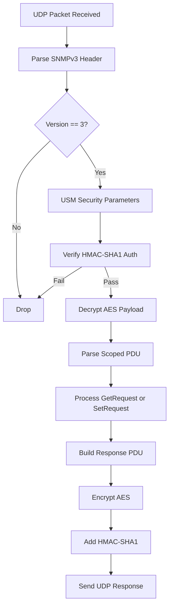

# SNMPv3 Library Plan for ESP32 / ESP32-S3 (Arduino + PlatformIO) - Updated

## Feasibility Analysis
- **Technically Possible**: Yes. arduino-esp32 core exposes ESP-IDF v5.5.4 mbedtls via `mbedtls/md.h` for HMAC-SHA1 and `mbedtls/aes.h` for AES-CFB. Basic SNMPv3 USM with authPriv level using SHA1 auth and AES privacy is implementable. Minimal BER encoder/decoder for GetRequest/SetRequest only. Prioritizes simplicity over full RFC compliance.
- **Dual Compatibility Impact**: Low. `library.properties` enables Arduino IDE and PlatformIO. No `library.json` needed. Minimal conditionals. Flat structure preserved.

## Updated Directory Structure (user-approved exception for example)
```
ESP32_SNMPv3/
├── library.properties
├── README.md
├── example.ino          // Basic usage sketch in root (approved exception)
├── plans/
│   └── plan.md
└── src/
    ├── SNMPv3.h
    └── SNMPv3.cpp
```

## Minimal Implementation Files
- `library.properties`: For Arduino/PIO compatibility.
- `src/SNMPv3.h`: Class with `begin()`, `addObject()`, `loop()`.
- `src/SNMPv3.cpp`: UDP (WiFiUdp), mbedtls crypto, basic BER for SNMPv3, USM, Get/Set handling.
- `example.ino`: Simple demo.
- Updated [`README.md`](README.md:1).

## High-Level Architecture (Mermaid Flowchart)


## Next Steps
Now switch to code mode to create the files as per this plan.

**User approved** with addition of `example.ino`.
